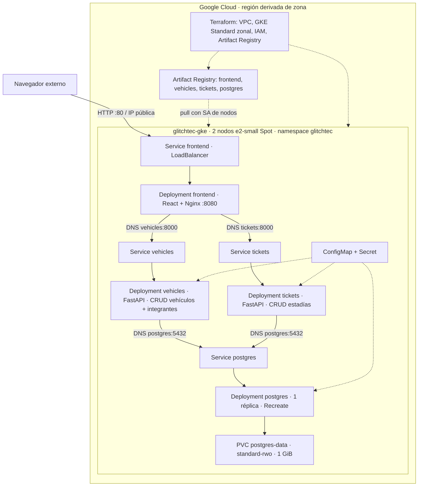

# GlitchTec · Parqueo público

Proyecto final de Virtualización, Universidad Rafael Landívar, segundo semestre 2026.
Caso 3: **Vehículos → Tickets de estadía**. Implementación nueva, sin código, datos ni
manifiestos de proyectos anteriores. Fuente de requisitos: `Proyecto FInal GKE.pdf`,
secciones 4-8, 11 y Anexo B (páginas 7-8). La tabla completa está en [docs/EVIDENCIAS.md](docs/EVIDENCIAS.md).

| Integrante | Carné |
|---|---|
| Mario Arévalo | 1072123 |
| Jonatán Chávez | 1185023 |
| Javier Ruano | 1207022 |
| Javier Aldana | 1184523 |
| Hector Pérez | 1304223 |
| José Rosales | 1143323 |

Los integrantes se insertan en PostgreSQL con `database/init/001-schema.sql` y la
interfaz los consulta por HTTP a `/api/vehicles/members`; no están codificados en React.

## Arquitectura



Todos los componentes usan **Deployments**, según E1 del PDF. PostgreSQL utiliza
`Recreate` para impedir dos escritores simultáneos sobre el PVC RWO. Los servicios
stateless usan `RollingUpdate`. Una sola base reduce memoria; cada API es un proceso,
imagen y despliegue independiente, y la FK garantiza integridad incluso ante carreras.
La API de tickets solo lee el identificador de vehículos y escribe tickets.
Terraform administra infraestructura GCP; **ningún recurso Kubernetes se crea con Terraform**.

## Requisitos locales

Docker Desktop iniciado en modo Linux y Docker Compose v2. Para pruebas fuera de
contenedores: Python 3.12, Node.js 22.15 o superior y npm. Para GCP: proyecto con
facturación, Google Cloud CLI, plugin `gke-gcloud-auth-plugin`, kubectl y Terraform
1.8 o superior, menor que 2.0. Los comandos siguientes son para PowerShell y se
ejecutan desde la raíz del repositorio, salvo donde se indica.

## Inicio local

```powershell
Set-Location C:\Users\hecto\glitchtec-parqueo
Copy-Item .env.example .env
# Editar .env y asignar POSTGRES_PASSWORD a una contraseña aleatoria de 16+ caracteres.
docker compose config --quiet
docker compose up -d --build --wait --wait-timeout 240
docker compose ps
python scripts/smoke.py http://localhost:8080
Start-Process http://localhost:8080
```

Abrir **http://localhost:8080**. Crear un vehículo; registrar una estadía; editarla
para registrar salida, tarifa o vehículo; consultar y eliminar tickets y vehículos.
Las confirmaciones de eliminación protegen contra errores de uso. No se puede eliminar
un vehículo con tickets: primero eliminar sus tickets. Se cobra Q por hora o fracción,
con mínimo de una hora; una estadía abierta todavía no tiene total. Las fechas se
muestran en la zona horaria del navegador y se envían/guardan en UTC.

Compose espera a que PostgreSQL tenga el esquema y seis miembros, después a que ambas
APIs estén saludables y finalmente inicia Nginx. Las APIs reintentan la conexión hasta
120 segundos. `/health` verifica el proceso; `/ready` consulta las tablas. Una pérdida
de DB quita disponibilidad sin convertirla en un ciclo de reinicios por liveness.

```powershell
docker compose logs --tail 80 vehicles tickets frontend
docker compose exec postgres psql -U parking -d parking -c 'SELECT * FROM members;'
docker compose restart postgres
python scripts/smoke.py http://localhost:8080
python scripts/persistence-smoke.py
docker compose down
# down conserva el volumen. down -v elimina TODOS los datos locales; usar solo al reiniciar desde cero.
```

`.env` no se versiona. La instalación entregada puede incluir un `.env` local generado
para la verificación; cada clon debe crear el suyo. No cambies la contraseña de `.env`
con un volumen existente esperando que cambie la contraseña dentro de PostgreSQL.
Para rotarla hay que ejecutar `ALTER ROLE` mediante `psql` interactivo y actualizar las
APIs; no registrar la contraseña en capturas ni en el historial de comandos.

## Pruebas automáticas y desarrollo

```powershell
python -m venv .venv
.\.venv\Scripts\python.exe -m pip install -r services/vehicles/requirements-dev.txt -r scripts/requirements.txt
.\scripts\test.ps1 -Python "$PWD\.venv\Scripts\python.exe"
Set-Location frontend
npm ci
npm run build
npm audit
Set-Location ..
```

Cada suite corre en un proceso distinto con SQLite en memoria: prueba CRUD, errores
404/409/422, integridad de vínculos, estado activo único, cobro, fechas y disponibilidad.
**SQLite no sustituye PostgreSQL**: `scripts/smoke.py` prueba ambos servicios vía Nginx
contra la base real y limpia sus propios registros incluso si falla. Ejecutar las dos
suites juntas en un único proceso mezcla los módulos `app` de los servicios; usa el script.
Las dependencias de runtime completas están fijadas en cada `requirements.txt`.
Hay una prueba opcional de navegador: instalar `playwright`, ejecutar
`python -m playwright install chromium` y `python scripts/ui-smoke.py` con Compose
activo. Crea/edita/elimina sus datos y actualiza las capturas locales de escritorio,
equipo y móvil en `docs/screenshots/`. Estas imágenes no son evidencia de GKE.
Para desarrollar React contra APIs nativas, usa `npm run dev` y puertos 8001/8002
configurados en `vite.config.js`; las APIs necesitan las variables PostgreSQL del entorno.

| Servicio | Endpoint público mediante Nginx | Operaciones |
|---|---|---|
| Vehículos | `/api/vehicles/vehicles` | GET lista paginada, POST |
| Vehículos | `/api/vehicles/vehicles/{id}` | GET, PUT completo, DELETE |
| Integrantes | `/api/vehicles/members` | GET desde DB |
| Tickets | `/api/tickets/tickets` | GET lista paginada, POST |
| Tickets | `/api/tickets/tickets/{id}` | GET, PUT completo, DELETE |
| Salud | `/api/{vehicles,tickets}/{health,ready}` | GET |

Listas: `?limit=200&offset=0`, máximo 1000 por petición. La UI obtiene todas las páginas.
OpenAPI JSON: `/api/vehicles/openapi.json` y `/api/tickets/openapi.json`. Swagger de
cada API se puede usar mediante port-forward al servicio (no necesita exposición pública).

## Pre-vuelo GCP y costo ANTES de desplegar

1. Publicar el caso 3 y los integrantes en el listado del portal, verificando que esté libre.
2. Crear una alerta de presupuesto en Billing → Budgets & alerts, por ejemplo USD 10
   con alertas 50/80/100%. El presupuesto **avisa, no detiene el gasto**.
3. Completar [docs/COSTOS.md](docs/COSTOS.md) con una cotización guardada y fecha antes de `apply` (G1).
4. Verificar cuenta, proyecto, facturación, APIs y cuota regional de IPs. Esta topología
   usa IPs públicas para los dos nodos y una IP del LoadBalancer: reservar cuota para al
   menos tres y comprobar la utilizada por otros recursos.

```powershell
$Project = "ID-REAL-DEL-PROYECTO"
$Zone = "us-central1-a"
$Region = "us-central1"
$Cluster = "glitchtec-gke"
gcloud auth login
gcloud config set project $Project
gcloud auth list
gcloud config list
gcloud billing projects describe $Project
gcloud services list --enabled --project $Project
gcloud compute regions describe $Region --project $Project --format="table(quotas.metric,quotas.limit,quotas.usage)"
terraform version
gke-gcloud-auth-plugin --version
```

No se ejecutó `apply`, `destroy`, publicación de imágenes ni cambios GCP durante la
implementación. Los comandos siguientes crean recursos facturables: ejecutarlos solo
cuando el equipo haya aprobado su costo y tenga permisos.

Permisos del operador: administrar GKE, redes Compute, Artifact Registry, cuentas de
servicio, vinculación IAM del proyecto y Service Usage. El administrador puede conceder
roles como `container.admin`, `compute.networkAdmin`, `artifactregistry.admin`,
`iam.serviceAccountAdmin`, `iam.serviceAccountUser`, `resourcemanager.projectIamAdmin`
y `serviceusage.serviceUsageAdmin`; limitarlos al proyecto de laboratorio. Quien solo
publica imágenes requiere `artifactregistry.writer`. La SA de nodos recibe lectura del
repositorio más permisos de operación/logging/monitoring mediante Terraform. No crear
claves JSON: usar credenciales de usuario/ADC. Políticas de organización pueden requerir
intervención del administrador; no habilitar recursos fuera de este diseño para evitarlas.

## Terraform: plan y creación autorizada

```powershell
gcloud auth application-default login
Copy-Item infra/terraform.tfvars.example infra/terraform.tfvars
# Editar project_id, zone, cluster_name, repository_id y master_authorized_cidr.
# master_authorized_cidr debe ser tu IP pública actual/32, no tu IP privada LAN.
Set-Location infra
terraform init
terraform fmt -check -recursive
terraform validate
terraform plan -out=glitchtec.tfplan
# Capturar el plan para D3 ANTES de continuar. No versionar el plan ni el estado.
terraform apply glitchtec.tfplan
# Guardar captura del resultado para D4.
$Project = terraform output -raw project_id
$Registry = terraform output -raw registry
$Cluster = terraform output -raw cluster_name
$Zone = terraform output -raw zone
$Region = terraform output -raw region
Set-Location ..
gcloud container clusters get-credentials $Cluster --zone $Zone --project $Project
gcloud container node-pools describe glitchtec-spot --cluster $Cluster --zone $Zone --project $Project --format="yaml(config.machineType,config.spot,initialNodeCount,autoscaling,upgradeSettings)"
kubectl get nodes -L cloud.google.com/gke-spot,node.kubernetes.io/instance-type
```

El proveedor está bloqueado en `infra/.terraform.lock.hcl`. Hay un pool temporal de un
nodo e2-small Spot que GKE requiere para crear el clúster con este proveedor; Terraform
lo elimina antes de crear el pool definitivo de **exactamente dos nodos, en una zona**.
No hay autoscaler de nodos ni pool adicional. `max_surge=0` impide un tercer nodo durante
upgrades del pool; `max_unavailable=1` puede causar interrupciones. No ejecutar `apply`
en paralelo ni modificar el pool desde la consola. Si cambia tu IP pública, actualizar
el CIDR y planificar/aplicar ese cambio para recuperar acceso al control plane.

El estado local contiene información de infraestructura: respaldarlo en almacenamiento
privado y coordinar un único operador. No subirlo a Git ni perderlo antes de destruir.
Antes de colaboración simultánea, configurar backend remoto GCS con acceso y locking;
no se aprovisiona un bucket adicional en este laboratorio mínimo.

## Publicar las CUATRO imágenes

```powershell
gcloud auth configure-docker "$Region-docker.pkg.dev"
.\scripts\publish.ps1 -Registry $Registry -Tag v1
gcloud artifacts docker images list $Registry --include-tags --project $Project
```

El script hace `docker build --platform linux/amd64` y `docker push` para frontend,
vehicles, tickets y **postgres**. La última imagen deriva de PostgreSQL oficial e incluye
esquema y seed propios: no basta con retaguear una imagen sin el SQL de inicialización.
Los manifiestos de aplicación renderizados solo referencian Artifact Registry. Los
Dockerfiles sí descargan bases oficiales al construir; eso no equivale a desplegarlas
directamente en GKE. No sobrescribir tags usados: v1, v2 o un SHA Git por release.

## Secret y aplicación en GKE

```powershell
python -m pip install -r scripts/requirements.txt
python scripts/render-k8s.py --registry $Registry --tag v1
.\scripts\new-secret.ps1
kubectl apply -f k8s/base/namespace.yaml
kubectl apply -f k8s/rendered/secret.yaml
kubectl apply -f k8s/rendered/app.yaml
kubectl -n glitchtec rollout status deployment/postgres --timeout=300s
kubectl -n glitchtec rollout status deployment/vehicles --timeout=300s
kubectl -n glitchtec rollout status deployment/tickets --timeout=300s
kubectl -n glitchtec rollout status deployment/frontend --timeout=300s
kubectl -n glitchtec get all
kubectl -n glitchtec get pvc
kubectl -n glitchtec get service frontend --watch
```

`k8s/base` es la fuente Kustomize, con rutas Artifact Registry de ejemplo; **no aplicar
el directorio con `kubectl apply -f k8s/base`**. Renderizar con el script primero; no
desplegar `REPLACE_PROJECT` ni `secret.example.yaml`. La contraseña se solicita oculta
y solo se escribe en `k8s/rendered/secret.yaml`, ignorado por Git. Base64 no es cifrado;
restringir acceso al archivo y no incluirlo en capturas. Para recrear un pod usando el
mismo PVC, mantener el mismo Secret. Cambiar el Secret no cambia la clave en la DB.

```powershell
$PublicIP = kubectl -n glitchtec get service frontend -o jsonpath='{.status.loadBalancer.ingress[0].ip}'
Start-Process "http://$PublicIP"
python scripts/smoke.py "http://$PublicIP"
kubectl -n glitchtec exec deployment/vehicles -- printenv DB_HOST POSTGRES_DB APP_VERSION
# Probar presencia del Secret sin revelar contraseña (E3):
kubectl -n glitchtec exec deployment/vehicles -- python -c "import os; print(bool(os.environ.get('POSTGRES_PASSWORD')))"
# Probar DNS desde el frontend (E6):
kubectl -n glitchtec exec deployment/frontend -- nslookup vehicles
kubectl -n glitchtec exec deployment/frontend -- nslookup tickets
kubectl -n glitchtec exec deployment/frontend -- cat /etc/nginx/conf.d/default.conf
kubectl -n glitchtec exec deployment/postgres -- psql -U parking -d parking -c 'SELECT * FROM members;'
```

Revisar la interfaz desde un navegador externo y la pestaña **Nuestro equipo**. Solo
frontend tiene LoadBalancer; PostgreSQL y APIs son ClusterIP internos. Este alcance
académico no incorpora login ni TLS: usar datos de demostración y mantenerlo público
solo durante las pruebas/defensa; para operación comercial se requieren controles de
acceso y HTTPS. No se incluye una afirmación de disponibilidad de producción sobre Spot.

## Operación: tres réplicas, autorrecuperación, rolling update y logs

Comandos individuales para aprender y verificar; el PDF prohíbe usar scripts preparados
para responder preguntas operativas durante la defensa. Cada integrante debe saber
explicarlos y escribirlos sin leer un guion.

**F1: escalamiento declarativo**, sin cambiar los dos nodos:

```powershell
python scripts/render-k8s.py --registry $Registry --tag v1 --scale3
kubectl apply -f k8s/rendered/scale3.yaml
kubectl -n glitchtec rollout status deployment/tickets --timeout=300s
kubectl -n glitchtec get deployment tickets
kubectl -n glitchtec get pods -l app=tickets -o wide
kubectl top nodes
kubectl -n glitchtec top pods
```

**F2: borrar un pod y comparar UID/nombre del reemplazo**:

```powershell
kubectl -n glitchtec get pods -l app=vehicles -o custom-columns=NAME:.metadata.name,UID:.metadata.uid
$Pod = kubectl -n glitchtec get pods -l app=vehicles -o jsonpath='{.items[0].metadata.name}'
kubectl -n glitchtec delete pod $Pod
kubectl -n glitchtec rollout status deployment/vehicles --timeout=180s
kubectl -n glitchtec get pods -l app=vehicles -o custom-columns=NAME:.metadata.name,UID:.metadata.uid
```

**E4: persistencia real**, crear un vehículo en la UI y guardar su id/placa antes de borrar
el pod de PostgreSQL. Capturar las consultas antes y después; no borrar el PVC:

```powershell
kubectl -n glitchtec exec deployment/postgres -- psql -U parking -d parking -c 'SELECT id,plate FROM vehicles;'
kubectl -n glitchtec get pvc
kubectl -n glitchtec delete pod -l app=postgres
kubectl -n glitchtec rollout status deployment/postgres --timeout=300s
kubectl -n glitchtec exec deployment/postgres -- psql -U parking -d parking -c 'SELECT id,plate FROM vehicles;'
```

**F3: versión v2**. Este ejemplo cambia la versión reportada de la API de vehículos y
su imagen. Primero publicar v2, luego aplicar YAML declarativo que conserva v1 en los
otros componentes y sus réplicas actuales. Se cambia también `APP_VERSION` del pod,
lo que permite ver la versión desde `/api/vehicles/health`.

```powershell
docker build --platform linux/amd64 -t "${Registry}/vehicles:v2" services/vehicles
docker push "${Registry}/vehicles:v2"
# Si se escaló a tres réplicas, usar scale3 como la base del rollout:
Copy-Item k8s/rendered/scale3.yaml k8s/rendered/app.yaml
python scripts/render-k8s.py --registry $Registry --tag v2 --rolling
kubectl apply -f k8s/rendered/rolling.yaml
kubectl -n glitchtec rollout status deployment/vehicles --timeout=300s
kubectl -n glitchtec rollout history deployment/vehicles
kubectl -n glitchtec get replicasets -l app=vehicles
Invoke-RestMethod "http://$PublicIP/api/vehicles/health"
# Reversión declarativa al documento anterior si se necesita:
kubectl apply -f k8s/rendered/app.yaml
```

Si no se hizo F1, omitir `Copy-Item scale3.yaml`: conservar el `app.yaml` original.
No aplicar otra vez un manifiesto de una réplica mientras se quiera mantener tres.
Para una versión de código distinta, modificar/commitear el cambio y publicar un tag
nuevo antes de repetir el procedimiento; no reusar un tag esperando que Kubernetes lo detecte.

**F4: logs y diagnóstico**:

```powershell
kubectl -n glitchtec logs deployment/vehicles --tail=100 --timestamps
kubectl -n glitchtec logs -l app=tickets --all-containers --prefix --tail=100
kubectl -n glitchtec get events --sort-by=.lastTimestamp
kubectl -n glitchtec describe pod NOMBRE-DEL-POD
```

## Recursos y recuperación

| Componente | Réplicas base | Request CPU/memoria | Límite CPU/memoria |
|---|---:|---|---|
| PostgreSQL | 1 | 50m / 96Mi | 400m / 256Mi |
| Vehículos | 1 | 25m / 80Mi | 300m / 192Mi |
| Tickets | 1 (3 en overlay) | 25m / 80Mi por pod | 300m / 192Mi por pod |
| Frontend | 1 | 10m / 16Mi | 150m / 64Mi |

Base: 110m CPU y 272Mi memoria solicitados. Con tickets a 3: 160m y 432Mi;
un pod extra de vehículos durante rollout añade 25m/80Mi. A esto se suman pods y
reservas de GKE. Dos e2-small no proporcionan toda su memoria al usuario y comparten
CPU; comprobar `kubectl describe nodes` y `kubectl top` después de desplegar. Requests
no son consumo medido ni garantía de capacidad. Con carga, subir límites dentro del
presupuesto de los mismos dos nodos; no aumentar tipo/número de nodos contra el PDF.

No se fuerza anti-afinidad: tres réplicas deben poder distribuirse en dos nodos. El
PVC zonal reatacha en la misma zona; Spot puede interrumpir ambos nodos y causar
indisponibilidad temporal. PostgreSQL de una réplica no es alta disponibilidad.
La imagen inicializa el esquema solo cuando PGDATA está vacío. Para cambios futuros
usar migraciones SQL versionadas y respaldos, no borrar el volumen como migración.

| Síntoma | Comprobación y recuperación |
|---|---|
| ImagePullBackOff | Ver `describe pod`, ruta/tag y listado AR. Verificar SA de nodos con reader y scope cloud-platform. |
| PVC Pending | `kubectl get storageclass`; `kubectl describe pvc -n glitchtec postgres-data`. Verificar `standard-rwo`, cuota de discos y eventos. WaitForFirstConsumer puede esperar al pod. |
| EXTERNAL-IP pending | Esperar unos minutos y revisar eventos/cuota de IPs, reglas forwarding y permisos de Compute. |
| API no Ready | Logs, DB_HOST=postgres, Secret correcto, DB y esquema disponibles. No crear tablas desde múltiples réplicas. |
| Nginx 502 | Probar DNS, Endpoints y readiness de APIs; `kubectl -n glitchtec get endpointslices`. |
| Pod Pending | `describe pod`, recursos allocatable, taints, cuotas y disponibilidad Spot; no añadir nodos. |
| OOMKilled | `describe pod`, logs anteriores y métricas; reducir carga o ajustar límites dentro de capacidad. |
| Password authentication failed | Secret y credencial persistida difieren. Reponer la contraseña original o rotar con SQL interactivo. |
| No acceso a kubectl | Verificar cuenta/contexto/plugin y CIDR del control plane (la IP pública puede haber cambiado). |

**Respaldo antes de destruir/recrear**, usando salida binaria dentro del pod para evitar
la corrupción de `pg_dump -Fc` por redirección de PowerShell 5.1:

```powershell
New-Item -ItemType Directory -Force backups | Out-Null
$DbPod = kubectl -n glitchtec get pods -l app=postgres -o jsonpath='{.items[0].metadata.name}'
kubectl -n glitchtec exec $DbPod -- pg_dump -U parking -d parking -Fc -f /tmp/parking.dump
kubectl -n glitchtec cp "${DbPod}:/tmp/parking.dump" backups/parking.dump
# Tras recrear infraestructura y esperar a postgres (restauración reemplaza datos existentes):
kubectl -n glitchtec cp backups/parking.dump "${DbPod}:/tmp/parking.dump"
kubectl -n glitchtec exec $DbPod -- pg_restore -U parking -d parking --clean --if-exists --no-owner /tmp/parking.dump
```

Después de recrear, volver a obtener `$DbPod` antes de copiar/restaurar. Detener escrituras
de las APIs durante una restauración: guardar sus réplicas, aplicar un YAML con réplicas
0, restaurar y reponer el manifiesto deseado. Respaldos ignorados por Git; protegerlos.
El PVC sobrevive a borrar un pod, **no** a destruir el namespace/cluster/disco.

## Destrucción autorizada y cierre

No ejecutar hasta contar con autorización del responsable del proyecto y con evidencia/
respaldo necesarios. El PDF pide destruir inmediatamente después de la defensa y
entregar evidencia antes del **13 de noviembre de 2026, 23:59**.

```powershell
gcloud config list
Get-Date
kubectl -n glitchtec delete service frontend
# Esperar y verificar que desaparezcan la IP/reglas de forwarding del LB.
gcloud compute forwarding-rules list --filter="region:$Region" --project $Project
kubectl -n glitchtec delete deployment frontend vehicles tickets postgres
kubectl -n glitchtec delete pvc postgres-data --wait=true
kubectl get pv
# Esperar que el PV/disco administrado por Kubernetes haya sido eliminado.
kubectl delete namespace glitchtec --wait=true
# El repositorio no puede eliminarse mientras contenga imágenes.
# BORRA todas las versiones de estas cuatro imágenes del proyecto dedicado:
gcloud artifacts docker images delete "${Registry}/frontend" --delete-tags --quiet
gcloud artifacts docker images delete "${Registry}/vehicles" --delete-tags --quiet
gcloud artifacts docker images delete "${Registry}/tickets" --delete-tags --quiet
gcloud artifacts docker images delete "${Registry}/postgres" --delete-tags --quiet
Set-Location infra
terraform plan -destroy
terraform destroy
# Capturar la salida real para G2, sin inventarla.
terraform state list
Set-Location ..
gcloud container clusters list --project $Project
gcloud compute instances list --project $Project
gcloud compute disks list --project $Project
gcloud compute addresses list --project $Project
gcloud compute forwarding-rules list --project $Project
gcloud artifacts repositories list --location $Region --project $Project
```

Comprobar que no quedan recursos `glitchtec` ni discos `pvc-*` de este namespace. No
eliminar recursos ajenos. Si falla destroy, conservar el estado, resolver dependencias
y repetir; Terraform no conoce LB/PV creados por kubectl. Las APIs habilitadas permanecen
habilitadas intencionalmente y no generan costo por sí solas. Guardar captura de Billing
con gasto final cuando se reflejen los cargos (pueden tener retraso), criterio G3.

## Entrega, evidencias y límites de la verificación

- [docs/EVIDENCIAS.md](docs/EVIDENCIAS.md): A1-G3, puntos exactos y capturas requeridas.
- [docs/COSTOS.md](docs/COSTOS.md): estimación preliminar mensual y de una sesión.
- [docs/VALIDACION.md](docs/VALIDACION.md): resultados realmente ejecutados y pendientes.
- [docs/DEFENSA.md](docs/DEFENSA.md): conceptos y diagnóstico para estudiar, no guion de respuestas.

Subir al portal el enlace Git y un **PDF de evidencias ordenado A-G**, incluyendo este
diagrama. Todas las capturas deben mostrar **reloj del sistema y salida de `gcloud config
list` con el proyecto**. Conservarlas completas; no confundir un log local con una
captura de GKE. El plazo de entrega es **10 de noviembre de 2026, 17:59**, hora de
Guatemala; defensa de 12 minutos el 10 de noviembre (continuación 12 de noviembre).
Todos deben estar presentes y el clúster accesible. A1 requiere 10 commits en 3 días:
no se puede cumplir con fechas retroactivas ni con commits vacíos. Si no existe ese
historial, comunicarlo honestamente; el código implementado no satisface por sí solo A1.
